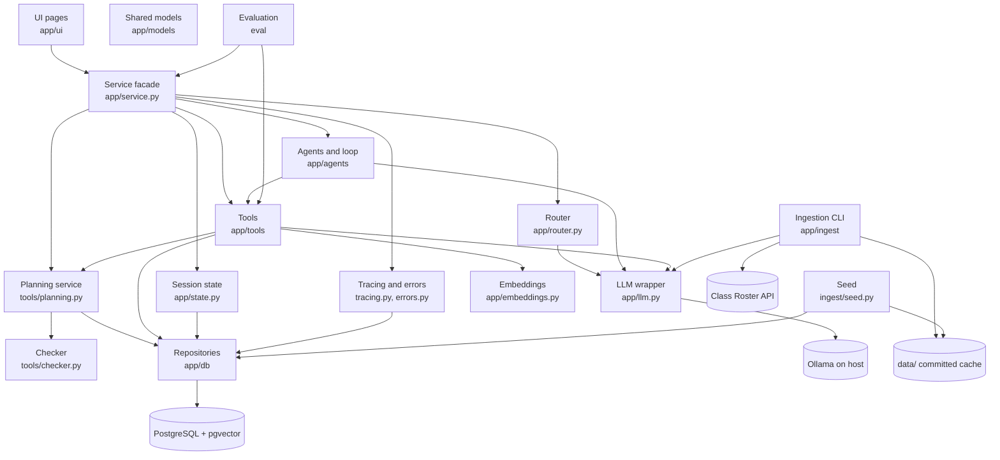
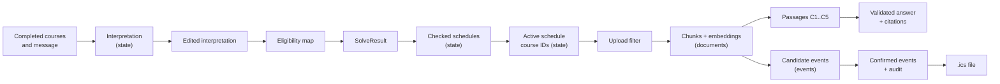

# CoursePilot: Application Design

**Stage**: INCEPTION - Application Design
**Date**: 2026-11-24
**Plan**: `aidlc-docs/inception/plans/application-design-plan.md` (Q1–Q8 and Follow-up 1 answered)

This document consolidates `components.md`, `component-methods.md`, `services.md` and `component-dependency.md`. Those four files are the sources. Edit them, not this copy. Detailed business rules are left to Functional Design for each unit.

---

## Design Decisions

| ID | Decision | Source |
|---|---|---|
| AD-01 | **Hybrid planning.** Button actions (Find schedules, pin, exclude) call the deterministic phase 2 service directly. Chat refinements go through the planner's agent loop (`REFINE_SPEC`), which calls the model-callable `solve_schedule` tool. That tool takes only `ConstraintChanges` and calls the **same** phase 2 service. One solving path, and FR-AGT-04 and FR-PLN-05 are unchanged | Q1:C, Follow-up 1:A |
| AD-02 | **Service facade.** `app/service.py` exposes `handle_message` plus named action functions, each traced, validated and wrapped by the top-level error handler. The UI imports only `app.service` and `app.models` | Q2:A |
| AD-03 | **Session state** is one validated `jsonb` document per session, with a schema version, loaded and saved once per request. Messages, events and their audit records, documents and traces have their own tables | Q3:A |
| AD-04 | **Independent checker.** It shares only `app.models` with the solver. An import-boundary test enforces this | Q4:A |
| AD-05 | **Committed ingestion cache.** `data/` holds the raw export and the derived envelopes. The seed script re-validates them and **re-runs the deterministic trust gate checks** on load | Q5:A, MC-04 |
| AD-06 | **Data-driven agent loop.** `run_agent(spec: AgentSpec)`. The spec's tool allowlist enforces per-agent tools (MS-02) | Q6:A |
| AD-07 | **Synchronous execution** with `st.status` progress. Waits are bounded by the solver time limit and the call budget | Q7:A |
| AD-08 | **One repository module per aggregate**, with typed functions returning Pydantic models and ordered plain-SQL migrations | Q8:A |
| AD-09 | **Shared models package** `app/models/`, so the solver and the checker can share data models without sharing logic. Now listed in technical-environment.md §1, together with `config.py`, `errors.py` and `embeddings.py` | AD-04 |
| AD-10 | **Deadline extraction runs when a document's review is first opened** (cached afterward), not at upload time, so uploads stay fast | Design choice |
| AD-11 | **Phase 1 can't solve.** `interpret` runs with `INTERPRET_SPEC`, whose allowlist is only `search_courses`. `solve_schedule` exists only in `REFINE_SPEC`. `explain` has no tools. Enforced by a test (R12) | Design review |
| AD-12 | **Ownership never comes from the model.** The session ID and student data come only from the server-built `AgentContext`. Every document, event or active-course ID passes `app.tools.ownership` checks before any action, in tools and service actions alike. Catalog IDs must exist in the ingested term. Failures return `ToolError(forbidden \| unknown_id)`. Repositories also filter by `session_id`. A SECURITY-05/11 control (R11) | Design review |

---
## Part 1: Components

*Source: `components.md`*

Components follow the code layout in technical-environment.md §1. Owner areas: **DATA** course data and solver; **PLAN** planner, router and memory; **MAT** course materials and deadlines; **UX** UI, tracing and evaluation; **SHARED** is the Foundation, built first. Units Generation finalizes which unit each component belongs to.

Components marked 🔒 hold security-critical logic, which NFR-SEC-11 requires to live in dedicated modules.

---

### 1. Presentation Layer (`app/ui/`)

| ID | Component | Module | Owner | Purpose and responsibilities | Serves |
|---|---|---|---|---|---|
| UI-1 | Chat page | `app/ui/chat.py` | UX | The main page: the chat input and transcript, the **completed-courses sidebar** (multiselect plus free text), the **interpretation panel** (edit constraints and topic sets, the "default" credit-range label, pin or exclude solver-chosen courses), the **schedule comparison** (A, B and C, weekly view, conditions, "Keep this schedule"), the **citation viewer**, upload, and progress feedback (`st.status`). Calls only `app/service.py` | US-01–04, 07, 09, 11–13 |
| UI-2 | Deadline review page | `app/ui/deadlines.py` | UX | The per-document review table (wording, interpreted date, source, status), editing and confirming rows, the per-course anchor override, and the `.ics` download button. Calls only `app/service.py` | US-14, 15 |
| UI-3 | Trace viewer page | `app/ui/traces.py` | UX | Lists and filters traces and shows a trace's details. Calls only `app/service.py` | US-21 |

---

### 2. Service Layer

| ID | Component | Module | Owner | Purpose and responsibilities | Serves |
|---|---|---|---|---|---|
| SV-1 | Service facade 🔒 | `app/service.py` | SHARED (lead PLAN) | The **only** entry point for the UI (Q2:A). `handle_message` for chat, plus named action functions for button clicks. Each call creates a trace, loads and saves `SessionState`, validates its inputs, and runs inside the top-level error handler (SECURITY-15) | All stories |
| SV-2 | Planning service | `app/tools/planning.py` | DATA | **Phase 2 solve**, the single solving path used by both the button and the `solve_schedule` tool (Q1:C, Follow-up 1:A). It applies `ConstraintChanges`, gathers candidates, runs `check_prereqs` for each candidate, then the solver, then the **checker**, and drops any schedule that fails. Model-free | US-03, 05, 07, 08 |
| SV-3 | Document service | `app/tools/documents.py` | MAT | Upload pipeline: validation (through UP-1), text extraction, section detection, chunking, embedding and storage. Model-free | US-11 |

---

### 3. Routing and Agents (`app/router.py`, `app/agents/`)

| ID | Component | Module | Owner | Purpose and responsibilities | Serves |
|---|---|---|---|---|---|
| AG-1 | Router | `app/router.py` | PLAN | Classifies intent from the message, the last 3 turns and state, using the router model and returning a validated `RouteDecision`. Decides whether to ask a clarifying question (confidence threshold, ambiguous references) | US-02, 12, 13 |
| AG-2 | Agent loop 🔒 | `app/agents/loop.py` | SHARED (lead PLAN) | `run_agent(spec, …)` (Q6:A). The model asks for a tool, the loop checks it against the spec's **allowlist**, validates the arguments, runs the tool with the server-built `AgentContext`, and returns the result or a structured error. Enforces the 8-call budget, records each call in the trace, and runs the spec's finalizer. **The session and every ownership ID come from `AgentContext`, never from model arguments (AD-12)** | US-03, 12, MS-02 |
| AG-3 | Planner agent | `app/agents/planner.py` | PLAN | Two `AgentSpec`s (AD-11). `INTERPRET_SPEC` allows **only** `search_courses`, so phase 1 **cannot solve**. `REFINE_SPEC` allows `search_courses`, `check_prereqs`, `check_requirements` and `solve_schedule`. **Phase 1** (`INTERPRET_SPEC`): the request becomes an `Interpretation`. **Refinement** (`REFINE_SPEC`): the reference becomes `ConstraintChanges`, then the agent calls `solve_schedule`. **Explanation:** one model call that explains phase 2 results. Also maps topic phrases to `TOPIC_TAGS` | US-02, 03, 05, 07, 08 |
| AG-4 | Materials agent | `app/agents/materials.py` | MAT | Its `AgentSpec` (prompt telling the model to ignore instructions inside documents, `AGENT_MODEL`, tools `search_materials`, `extract_deadlines` and `export_ics`). Rewrites the query with the router model first (FR-MAT-05, Tier 2, with an on/off switch). Labels passages `[C1]…`, then sends the answer to CV-1 for validation, retrying once | US-12, 13, 15, 16, MS-01 |

---

### 4. Tools (`app/tools/`)

**Model-callable tools** (registered in an `AgentSpec`):

| ID | Tool | Module | Owner | Agent | Purpose | Serves |
|---|---|---|---|---|---|---|
| T-1 | `search_courses` | `courses.py` | DATA | Planner | Query plus filters, returning up to 10 courses with sections and tags. Hybrid search: full-text plus pgvector over descriptions | US-02, 03 |
| T-2 | `check_prereqs` | `prereqs.py` | DATA | Planner | Maps the none, trusted, uncertain and missing statuses to a result, evaluating trusted trees with three-valued logic (technical-environment.md §6.2) | US-04 |
| T-3 | `check_requirements` | `requirements.py` | DATA | Planner | Progress and gaps for each category. Uncertain categories return `needs_confirmation`. **Tier 2** | US-06 |
| T-4 | `solve_schedule` | `solve_tool.py` (tool wrapper) | DATA | Planner | Input is `ConstraintChanges` only, and the implementation calls **SV-2**. The model never passes raw solver inputs | US-07, MS-02 |
| T-5 | `search_materials` | `materials.py` | MAT | Materials | Hybrid retrieval: full-text plus pgvector, course and document filters, 20 + 20 results fused with RRF, top 5 returned | US-12 |
| T-6 | `extract_deadlines` | `deadlines.py` | MAT | Materials | Candidate events from a document. The `document_id` must pass `ownership.require_document`. The model extracts wording, and dates are resolved through DT-1 | US-14, 16 |
| T-7 | `export_ics` | `export.py` | MAT | Materials | Builds an `.ics` file from **confirmed** events only, using `icalendar`. Takes **no model arguments**: the session comes from `AgentContext` | US-15 |

Every model-callable tool receives `(args, ctx: AgentContext)`. Its input model never contains a session ID or student data such as completed courses; those come from `ctx` (AD-12).

**Deterministic support** (not model-callable):

| ID | Component | Module | Owner | Purpose | Serves |
|---|---|---|---|---|---|
| SO-1 | CP-SAT solver | `solver.py` | DATA | Builds and solves the CP-SAT model: hard constraints (FR-ELG-03, including inclusions and fill), the penalty for `needs_confirmation` courses, soft-preference scoring, distinctness and the time limit | US-03 |
| CK-1 | Schedule checker 🔒 | `checker.py` | DATA | **Independent** re-validation (Q4:A). Imports only the shared models, never the solver or its helpers. A test enforces this | US-03, NFR-COR-01 |
| CV-1 | Citation validator 🔒 | `citations.py` | MAT | Checks that cited IDs are in the evidence retrieved for this request, that quoted dates and numbers appear in the passage (allowing equivalent formats), and the DEC-24 relative-date labeling rule | US-12, MS-01 |
| DT-1 | Date resolver | `dates.py` | MAT | Anchor precedence (per-course override, then `TERM_START`, then the derived anchor), DEC-25 Monday–Sunday weeks, `TODAY_OVERRIDE`, and America/New_York | US-14, 16 |
| UP-1 | Upload validator 🔒 | `uploads.py` | MAT | Size limit (20 MB) and PDF signature checks before parsing, plus rejection of PDFs with no extractable text | US-11, MS-03 |
| OW-1 | Ownership checks 🔒 | `ownership.py` | SHARED (lead MAT) | **Server-side ownership checks (AD-12, a SECURITY-05/11 control).** - `require_document`: the document belongs to `ctx.session_id`, and its course is in the active schedule. - `require_event`: the event belongs to `ctx.session_id`. - `require_active_course`: the course is in the active schedule. Used for materials filters, uploads and anchor overrides. - `require_catalog_course` and `require_catalog_section`: the ID exists in the configured term's ingested catalog. Used for planner tool IDs, because catalog courses are shared, not owned by a session. Each failure returns `ToolError(kind="forbidden")` or `ToolError(kind="unknown_id")`. Called by every tool **and** every service action that receives such an ID | MS-02 |

---

### 5. Ingestion (`app/ingest/`)

| ID | Component | Module | Owner | Purpose | Serves |
|---|---|---|---|---|---|
| IN-1 | Course source adapter | `sources/base.py` (protocol), `sources/class_roster.py` | DATA | `CourseSource` protocol. The Class Roster adapter fetches with `httpx` and validates every API response with Pydantic | US-17 |
| IN-2 | Prerequisite status classifier 🔒 | `prereq_status.py` | DATA | Classifies each prerequisite field as none, text or missing (FR-ING-02), in Python only, using `NO_PREREQ_PATTERNS` | US-17, 18 |
| IN-3 | Deriver | `derive.py` | DATA | Model calls for rule trees, topic tags, workload cues and requirement categories. Untrusted text is wrapped in delimiters, and outputs are validated with Pydantic | US-18, 19, MS-01 |
| IN-4 | Trust gate 🔒 | `trust_gate.py` | DATA | Deterministic checks (a)–(e) from FR-ING-07, with the `UNEXPRESSIBLE_PHRASES` constant. Pure functions, so they can be **re-run by the seed script** (see the misuse case "edited committed cache") | US-18, 19 |
| IN-5 | Cache | `cache.py` | DATA | Stores derived records in `data/` (committed, Q5:A), keyed by a hash of (input text, model, prompt version). Makes runs resumable | US-18, 20 |
| IN-6 | Anchor deriver | `anchor.py` | DATA | Finds the most common lecture start date, with `TERM_START` overriding it | US-17 |
| IN-7 | Ingestion CLI | `__main__.py` | DATA | `python -m app.ingest`: progress display and end-of-run summary | US-17, 20 |
| IN-8 | Seed loader | `seed.py` | DATA | Idempotent load of `data/` into Postgres at first start. Re-validates each record's schema and re-runs the deterministic trust gate checks | US-17 |

---

### 6. Foundation (shared, built first)

| ID | Component | Module | Owner | Purpose | Serves |
|---|---|---|---|---|---|
| FN-1 | Settings 🔒 | `app/config.py` | SHARED | Pydantic settings loaded from the environment (models, `num_ctx`, `TERM`, `SUBJECTS`, `TOPIC_TAGS`, thresholds, `DEFAULT_CREDIT_RANGE`, `TODAY_OVERRIDE`, `TERM_START`, `REQUIREMENTS_DOC`, `DATABASE_URL`). **Refuses to start while `POSTGRES_PASSWORD` is the placeholder** (NFR-SEC-09) | All |
| FN-2 | LLM wrapper | `app/llm.py` | SHARED | `chat` and `chat_structured` (technical-environment.md §6.4). Sets `num_ctx`, temperature 0, and whether thinking is on, and reports token counts. The only module that imports `ollama` | All model use |
| FN-3 | Embeddings | `app/embeddings.py` | SHARED | Loads the `bge-small-en-v1.5` model once per process and provides `embed(texts)` | T-1, T-5, SV-3 |
| FN-4 | Database | `app/db/connection.py`, `migrations/*.sql`, `migrate.py` | SHARED | Connection pool and an ordered plain-SQL migration runner (Q8:A) | All repositories |
| FN-5 | Repositories | `app/db/{courses,derived,sessions,documents,events,traces}_repo.py` | Each area owns its repo | Typed functions that return Pydantic models. All SQL is parameterized | All persistence |
| FN-6 | Session state | `app/state.py` | PLAN | The `SessionState` model (with a schema version), `load_state` and `save_state` as one `jsonb` document (Q3:A), and the running summary trigger (Tier 2) | US-01, 09, 13 |
| FN-7 | Tracing and logging | `app/tracing.py` | UX | Creates `Trace`, records spans for tools and model calls, writes `record_trace`, and configures the structured logger (SECURITY-03). Never stores document text | US-21 |
| FN-8 | Errors 🔒 | `app/errors.py` | SHARED | `UserFacingError`, `safe_call` and the top-level handler: log with the `trace_id`, return a generic message, fail closed (SECURITY-15) | All |
| FN-9 | Shared models | `app/models/{courses,derived,planning,materials,events}.py` | SHARED (each area owns its file) | Pydantic models shared across components. This is the neutral module that lets the solver and the checker share **only data models** (Q4:A). It holds no logic beyond validators. Listed in technical-environment.md §1 (AD-09) | All |

---

### 7. Evaluation (`eval/`)

| ID | Component | Module | Owner | Purpose | Serves |
|---|---|---|---|---|---|
| EV-1 | Evaluation runner | `eval/run.py`, `eval/suites/*.py` | UX (suites from every owner) | Runs the 8 suites against `app.service` and the tools. Records configuration, latency and tokens, and writes the report. `app/` never imports `eval/` (FR-EVAL-05) | US-22 |

---

### Requirement-area Coverage

| FR area | Components |
|---|---|
| FR-ING | IN-1–IN-8, FN-3 |
| FR-PLN | AG-3, SV-2, T-1, UI-1 |
| FR-ELG | T-2, T-3, T-4, SV-2, SO-1, CK-1 |
| FR-REF | AG-3, T-4, SV-2 |
| FR-SEL | SV-1, FN-6 |
| FR-MAT | SV-3, UP-1, T-5, AG-4, CV-1, UI-1 |
| FR-DL | T-6, T-7, DT-1, UI-2, FN-5 (`events_repo`) |
| FR-RTE | AG-1, SV-1 |
| FR-AGT | AG-2, AG-3, AG-4 |
| FR-MEM | FN-6, AG-1 |
| FR-TRC | FN-7, UI-3 |
| FR-EVAL | EV-1 |
| FR-UI | UI-1, UI-2, UI-3 |

---

## Part 2: Component Methods

*Source: `component-methods.md`*

These are signatures and purposes only. **Business rules are designed per unit in Functional Design.** Every input and output type is a Pydantic v2 model (TC-02), and every string field gets an explicit maximum length, with values set in NFR Requirements (SECURITY-05). Type names are proposals that Functional Design may refine without changing a method's role.

---

### 1. Shared Models (`app/models/`, FN-9)

| File | Main models |
|---|---|
| `courses.py` | `Meeting(days, start, end, start_date, end_date)`, `Section(section_id, component, meetings, credits)`, `Course(course_id, cross_listings, title, description, credits, components, sections, prereq_field: PrereqField)` |
| `derived.py` | `PrereqRule` (technical-environment.md §6.2), `PrereqStatus` (enum: `none`, `trusted`, `uncertain`, `missing`), `PrereqRecord(course_id, status, rule, source_text, model_score, failed_checks)`, `TopicTag(tag: TopicTagEnum, confidence, justification, uncertain)`, `WorkloadSignal(score, cues)`, `RequirementCategory(name, rule: CategoryRule, status, source_text)`, `GateResult(trusted, failed_checks)`, `DerivedRecordEnvelope(input_hash, model, prompt_version, created_at, payload)` |
| `planning.py` | `Interpretation(hard: HardConstraints, soft: SoftPreferences, credit_range: CreditRange(min, max, is_default), topic_sets: list[TopicSet], inclusions, exclusions)`, `ConstraintChanges(replace_sections, add_hard, remove, pin, exclude, set_credit_range)`, `EligibilityMap`, `Schedule(label, sections, credits, workload, preferences_met, conditions, solver_chosen: list[course_id])`, `SolveResult(kind: Literal["schedules", "infeasible", "timeout"], schedules, conflicts)`, `CheckReport(ok, violations)` |
| `materials.py` | `DocumentMeta`, `Chunk(chunk_id, course_id, document_id, heading, pages, text)`, `Passage(label: "C1"…, chunk)`, `Citation(chunk_id, document, section, pages, text)`, `CitationCheck(valid, problems)`, `RewrittenQuery(queries, course_filters, date_range)` |
| `events.py` | `CandidateEvent(event_id, course_id, assignment, original_wording, interpreted: datetime | date | None, all_day, source_chunk_id, status: EventStatus, anchor_source)`, `EventStatus` (enum: `awaiting_review`, `confirmed`, `conflict`, `tbd`), `EventEdit`, `EventAudit(event_id, at, before, after)` |

---

### 2. Service Facade: `app/service.py` (SV-1)

Every function creates a `Trace`, runs inside `errors.top_level(trace)`, validates its inputs, loads and saves `SessionState` when it uses session state, and returns a validated response model.

| Method | Input | Output | Purpose |
|---|---|---|---|
| `handle_message(session_id: str, text: str)` | text ≤ max length | `ChatResponse` | Chat entry point: routes the message, then runs the planner (phase 1 or a refinement), the materials agent, a clarifying question, or the out-of-scope reply |
| `set_completed_courses(session_id, completed: list[str], reported_equivalents: list[str])` | course IDs, free text | `SessionSnapshot` | Sidebar updates (US-01) |
| `solve_confirmed(session_id, interpretation: Interpretation)` | edited panel | `PlanResponse` | "Find schedules": runs phase 2 through SV-2, then the planner's explanation call (Q1:C) |
| `apply_changes(session_id, changes: ConstraintChanges)` | pin, exclude, credit-range edit | `PlanResponse` | Button edits re-run phase 2 directly (DEC-22) |
| `keep_schedule(session_id, label: str)` | `"A"`, `"B"` or `"C"` | `SessionSnapshot` | Sets the active schedule (FR-SEL-01) |
| `upload_document(session_id, course_id: str, filename: str, data: bytes)` | `require_active_course`, ≤ 20 MB | `DocumentMeta` | Runs SV-3 for a course in the active schedule |
| `open_deadline_review(session_id, document_id: str)` | `require_document` | `list[CandidateEvent]` | Runs `extract_deadlines` the first time (cached in `events_repo` after that), then returns the rows |
| `update_event(session_id, event_id: str, edit: EventEdit)` | `require_event`, plus the edited date, time or status | `CandidateEvent` | Edit, resolve a conflict, fill a TBD date, or confirm. Writes an `EventAudit` (FR-DL-07) |
| `set_anchor_override(session_id, course_id: str, anchor: date)` | `require_active_course` | `list[CandidateEvent]` | Per-course week-one override. Re-resolves the course's events |
| `export_calendar(session_id)` | | `IcsFile(filename, content: bytes) \| NothingToExport` | Download button, through `export_ics` |
| `list_traces(filters: TraceFilter)` / `get_trace(trace_id: str)` | | `list[TraceSummary]` / `Trace` | Trace viewer (Tier 2) |

---

### 3. Router: `app/router.py` (AG-1)

| Method | Input | Output | Purpose |
|---|---|---|---|
| `route_message(text: str, state: SessionState, *, trace: Trace)` | | `RouteDecision(intent, details, confidence, clarifying_question)` | Router-model classification with structured output, plus clarification decided from both state and confidence |
| `_needs_clarification(decision: RouteDecision, state: SessionState)` | | `str \| None` | Deterministic checks for ambiguous references (for example two 8 AM sections) and the confidence threshold |

---

### 4. Agent Loop: `app/agents/loop.py` (AG-2)

| Item | Signature | Purpose |
|---|---|---|
| `AgentContext` | `AgentContext(session_id, active_course_ids, completed_courses, reported_equivalents, interpretation)` | **Built by the service from server-side `SessionState`, never from model output (AD-12).** Passed to every tool |
| `ToolSpec` | `ToolSpec(name, description, input_model: type[BaseModel], output_model: type[BaseModel], fn: Callable[[InputModel, AgentContext], OutputModel])` | One allowlisted tool. A test checks that no `input_model` declares a session ID or student-data field |
| `AgentSpec` | `AgentSpec(name, system_prompt, model, tools: dict[str, ToolSpec], max_calls: int = 8, finalizer: Callable[[LoopResult], R])` | Agent definition (Q6:A) |
| `run_agent` | `run_agent(spec: AgentSpec, messages: list[dict], *, context: AgentContext, trace: Trace) -> R` | Runs the loop: allowlist check → validate the arguments → run the tool → return the result or a structured error → repeat until there is a final answer or the budget runs out. Rejected and invalid calls are never run (MS-02) |
| `ToolError` | `ToolError(kind: Literal["invalid_args", "unknown_tool", "missing_info", "no_match", "forbidden", "unknown_id", "failed"], message)` | Structured errors the model can see and correct (FR-ELG-10, FR-AGT-02) |

### 5. Planner Agent: `app/agents/planner.py` (AG-3)

| Method | Input | Output | Purpose |
|---|---|---|---|
| `interpret(text, state, *, trace)` | | `Interpretation` | Phase 1, run with `INTERPRET_SPEC`, so it **cannot call `solve_schedule`**. Applies `DEFAULT_CREDIT_RANGE` when no range is given and maps topic phrases to `TOPIC_TAGS` |
| `refine(text, decision, state, *, trace)` | | `PlanResponse` | Refinement loop, run with `REFINE_SPEC`, that resolves the reference into `ConstraintChanges` and calls the `solve_schedule` tool (Follow-up 1:A) |
| `explain(result: SolveResult, interpretation, *, trace)` | | `str` | The single explanation call after phase 2, with **no tools**. It describes the structured results and never changes them |
| `INTERPRET_SPEC` | | `AgentSpec` | Allowlist: `search_courses` **only** (AD-11) |
| `REFINE_SPEC` | | `AgentSpec` | Allowlist: `search_courses`, `check_prereqs`, `check_requirements`, `solve_schedule` |

### 6. Materials Agent: `app/agents/materials.py` (AG-4)

| Method | Input | Output | Purpose |
|---|---|---|---|
| `run(text, decision, state, *, trace)` | | `ChatResponse` | Answers a question with citations, validated by CV-1 with one retry. Unverified answers are labeled |
| `rewrite_query(text, state, *, trace)` | | `RewrittenQuery` | Router-model rewrite. `REWRITE_ENABLED` switches it off for evaluation (Tier 2) |
| `MATERIALS_SPEC` | | `AgentSpec` | Tools: `search_materials`, `extract_deadlines`, `export_ics` |

---

### 7. Tools: `app/tools/`

| Tool or method | Input model | Output model | Notes |
|---|---|---|---|
| `search_courses(args: SearchCoursesInput, ctx)` | query, level, days, credits (the term comes from configuration) | `SearchCoursesOutput(courses[≤10])` | T-1 |
| `check_prereqs(args: CheckPrereqsToolInput, ctx)` | course_id (`require_catalog_course`) | `CheckPrereqsOutput(status, rule_text, source_text, reason)` | T-2. The tool wrapper fills `completed_courses` and `reported_equivalents` from `ctx`, then calls the pure `check_prereqs(CheckPrereqsInput, …)` from technical-environment.md §6.2. The model can't claim courses the student hasn't entered |
| `check_requirements(args: CheckRequirementsToolInput, ctx)` | proposed course IDs (`require_catalog_course`), with completed courses from `ctx` | `CheckRequirementsOutput(categories: list[CategoryProgress])` | T-3, Tier 2 |
| `solve_schedule(args: SolveScheduleInput, ctx)` | `ConstraintChanges` (every course and section ID passes `require_catalog_*`), with state from `ctx` | `PlanResponse` | T-4, in `solve_tool.py`. Calls `planning.solve_with_checks` |
| `planning.solve_with_checks(interpretation, changes, state, *, trace)` | | `SolveResult` | SV-2: gather candidates → `EligibilityMap` → `solver.solve` → `checker.check` on each → drop failures and trace them |
| `solver.solve(problem: SolveProblem, *, time_limit_s)` | candidates, eligibility, constraints, preferences | `SolveResult` | SO-1 |
| `checker.check(schedule: Schedule, problem: SolveProblem)` | | `CheckReport` | CK-1. Independent of the solver |
| `search_materials(args: SearchMaterialsInput, ctx)` | queries, plus optional course filters (`require_active_course`) and document filters (`require_document`). The default filter is the active schedule's courses | `SearchMaterialsOutput(passages[≤5])` | T-5 |
| `citations.validate(answer: DraftAnswer, evidence: list[Passage])` | | `CitationCheck` | CV-1 |
| `extract_deadlines(args: ExtractDeadlinesInput, ctx)` | document_id (`require_document`). The course calendar context is built server-side from the anchors | `ExtractDeadlinesOutput(events)` | T-6. Resolves dates through DT-1 |
| `dates.resolve(wording_parts: RelativeDate, anchors: AnchorSet)` | | `ResolvedDate(value, all_day, anchor_source)` | DT-1 |
| `dates.week_range(today: date)` | | `tuple[date, date]` | DT-1, Monday–Sunday (DEC-25) |
| `dates.today()` | | `date` | `TODAY_OVERRIDE` or the current date in America/New_York |
| `export_ics(args: ExportIcsInput, ctx)` | **none** (an empty model), with the session from `ctx` | `IcsFile \| NothingToExport` | T-7. Confirmed events of `ctx.session_id` for the active schedule's courses only |
| `ownership.require_document(ctx, document_id)` / `require_event(ctx, event_id)` / `require_active_course(ctx, course_id)` / `require_catalog_course(course_id)` / `require_catalog_section(section_id)` | | the owned record, or `ToolError(forbidden \| unknown_id)` | OW-1 |
| `uploads.validate(filename, data: bytes)` | | `ValidatedPdf` or raises `UploadRejected` | UP-1 |
| `documents.ingest(course_id, pdf: ValidatedPdf)` | | `DocumentMeta` | SV-3 |

---

### 8. Ingestion: `app/ingest/`

| Method | Input | Output | Purpose |
|---|---|---|---|
| `CourseSource.fetch(term: str, subjects: list[str])` (protocol) | | `RawExport` | IN-1 |
| `ClassRosterSource.fetch(...)` | | `RawExport` | `httpx`, with Pydantic validation of every response |
| `prereq_status.classify(field: PrereqField)` | present and text, or absent | `Literal["none", "text", "missing"]` | IN-2, pure |
| `derive.prereq_rule(course: Course)` | | `PrereqRecord` | IN-3 → IN-4 |
| `derive.topic_tags(course: Course, vocabulary: list[str])` | | `list[TopicTag]` | IN-3 |
| `derive.workload(course: Course)` | | `WorkloadSignal` | IN-3, Tier 2 |
| `derive.requirement_categories(doc_text: str)` | | `list[RequirementCategory]` | IN-3 → IN-4, Tier 2 |
| `trust_gate.check_rule(rule: PrereqRule, source_text: str, score: float)` | | `GateResult` | IN-4, checks (a)–(e), pure |
| `trust_gate.check_category(category, source_text, score)` | | `GateResult` | IN-4, pure |
| `cache.get(key: CacheKey)` / `cache.put(key, envelope)` | | `DerivedRecordEnvelope \| None` | IN-5 |
| `anchor.derive(sections: list[Section], override: date \| None)` | | `date` | IN-6 |
| `main(argv)` | `--term`, `--subjects` | exit code | IN-7 |
| `seed.load(data_dir: Path)` | | `SeedReport` | IN-8. Idempotent upserts, re-validation and gate re-check |

---

### 9. Foundation

| Method | Output | Purpose |
|---|---|---|
| `config.get_settings()` | `Settings` | FN-1. Cached. Refuses to start on the placeholder password |
| `llm.chat(model, messages, tools=None, *, think: bool, trace)` | `LLMResult` | FN-2 |
| `llm.chat_structured(model, messages, schema: type[T], *, think: bool, trace)` | `T` | FN-2. Retries once, then raises `StructuredOutputError` |
| `embeddings.embed(texts: list[str])` | `list[list[float]]` | FN-3 |
| `db.connection.get_conn()` (context manager) | `psycopg.Connection` | FN-4. Rolls back on error |
| `db.migrate.run()` | `None` | FN-4 |
| `state.load_state(session_id)` / `state.save_state(session_id, state)` | `SessionState` / `None` | FN-6 |
| `state.SessionState.append_turn(user, assistant)` | `None` | FN-6 |
| `tracing.Trace` / `trace.span(name, **attrs)` (context manager) / `tracing.record_trace(trace)` | | FN-7 |
| `tracing.get_logger(name)` | `logging.Logger` | FN-7. Structured JSON on stdout |
| `errors.top_level(trace)` (context manager) | | FN-8. Catches, logs and turns errors into `UserFacingError` |
| Repositories: `courses_repo.*`, `derived_repo.*`, `sessions_repo.*`, `documents_repo.*` (including `fts_search` and `vector_search`), `events_repo.*` (including `audit`), `traces_repo.*` | Pydantic models | FN-5. All SQL is parameterized |

### 10. Evaluation: `eval/`

| Method | Output | Purpose |
|---|---|---|
| `eval.run.main(argv)` | report files | EV-1. Options: `--suite`, `--final`/`--dev`, `--rewrite on\|off` |
| `eval.suites.<name>.run(config: EvalConfig)` | `SuiteResult(counts, metrics, failures)` | One per suite in requirements §7 |

---

## Part 3: Services and Orchestration

*Source: `services.md`*

### 1. Service Definitions

| Service | Module | Kind | Responsibility |
|---|---|---|---|
| **Service facade** (SV-1) | `app/service.py` | Entry point | The only module the UI calls. Each call opens a `Trace` and runs inside `errors.top_level`. Calls that use session state load it at the start and save it at the end. Each call is synchronous, and the UI shows progress with `st.status` (Q7:A) |
| **Planning service** (SV-2) | `app/tools/planning.py` | Deterministic | Phase 2 solve, the **single solving path**. The "Find schedules", pin and exclude buttons call it through the facade, and chat refinements call it through the `solve_schedule` tool (Q1:C, Follow-up 1:A) |
| **Document service** (SV-3) | `app/tools/documents.py` | Deterministic | Upload pipeline: validate, extract, detect sections, chunk, embed, store |
| **Agent services** | `app/agents/planner.py`, `app/agents/materials.py` | Model-driven | Run `run_agent` with their `AgentSpec`, then apply post-processing (citation validation for materials, the explanation call for the planner) |
| **Ingestion** | `app/ingest/` (CLI) | Offline batch | Pulls the catalog, derives records, gates them and caches them in `data/`. Not part of the running app |
| **Seed** | `app/ingest/seed.py` | Startup | Loads the committed `data/` into Postgres, idempotently, with re-validation |

**Cross-cutting rules for every flow:**
- The model never enforces a hard rule. Python does (NFR-COR-03).
- Every model output is validated with Pydantic before use.
- Every tool call passes the spec's allowlist and input validation before it runs.
- Errors fail closed: nothing unvalidated is shown as verified, and the user sees a generic message.

---

### 2. Orchestration Flows

Each flow below is listed as numbered steps, which is also the text alternative for the diagrams in `component-dependency.md`. A **[model]** tag marks a model call.

#### F1: Chat planning request (phase 1), demo step 2
`handle_message` →
1. `load_state`. **[model]** `route_message` returns `plan_schedule`.
2. **[model]** `planner.interpret` runs the agent loop with **`INTERPRET_SPEC`, whose only allowed tool is `search_courses`**. Phase 1 therefore cannot produce schedules before the student confirms the panel (AD-11). It may call `search_courses` to resolve course and topic names. It returns an `Interpretation`, applying `DEFAULT_CREDIT_RANGE` if no range was given and filling `topic_sets` from tags: trusted tags pre-selected, uncertain tags listed but unselected (DEC-16).
3. Save `Interpretation` in state, `save_state`, `record_trace`.
4. Return `ChatResponse(interpretation=…)`. The UI renders the editable panel.

#### F2: "Find schedules" button (phase 2), demo steps 3–5
`solve_confirmed(session_id, interpretation)` →
1. Validate the edited `Interpretation`.
2. `planning.solve_with_checks` (see F2a).
3. **[model]** `planner.explain(result)` writes text from the structured results. The schedules shown come from `SolveResult`, never from the generated text.
4. Save the candidate schedules in state and return `PlanResponse`.

#### F2a: `planning.solve_with_checks` (SV-2), shared by F2, F3 and F4
1. Apply `ConstraintChanges`, if any, to the current `Interpretation`.
2. Gather candidates from `courses_repo`: courses in topic sets and inclusions, plus fill candidates (eligible ingested courses, minus exclusions) (DEC-22).
3. For each candidate, call `check_prereqs` to build an `EligibilityMap`. `unmet` courses are dropped, and `needs_confirmation` courses are kept with a penalty.
4. `solver.solve(problem, time_limit_s)` returns schedules, an infeasible result, or a timeout result.
5. `checker.check` runs on every schedule. Failing schedules are dropped, and each drop is recorded in the trace.
6. Mark the fill courses as `solver_chosen` and return the `SolveResult`.

#### F3: Chat refinement, "swap out the 8am" (Tier 2)
`handle_message` →
1. **[model]** `route_message` returns `refine_schedule`. If the reference is ambiguous (two 8 AM sections), return a clarifying question and stop.
2. **[model]** `planner.refine` runs the agent loop with `REFINE_SPEC`. The model resolves the reference and calls `solve_schedule(ConstraintChanges(replace_sections=[CS 4780-001]))`.
3. The tool validates the arguments and runs F2a. The result goes back to the model.
4. **[model]** The finalizer writes the reply. The loop allows at most 8 calls in total.

#### F4: Pin or exclude a solver-chosen course
`apply_changes(session_id, ConstraintChanges(pin=[…]) or (exclude=[…]))` → F2a → **[model]** `explain` → `PlanResponse`.

#### F5: Keep a schedule, demo step 6
`keep_schedule(session_id, "A")` → set `active_schedule` (course and section IDs) → `save_state`. No model call, and no call to any external system.

#### F6: Upload a syllabus, demo step 7
`upload_document(session_id, course_id, filename, data)` →
1. `ownership.require_active_course`: the course must be in the active schedule, otherwise reject.
2. `uploads.validate`: size, then signature, otherwise `UploadRejected` (MS-03).
3. `documents.ingest`: PyMuPDF text with page numbers, then section detection, then chunks of about 500 tokens, then `embed`.
4. Store everything with `documents_repo` in **one transaction**, so nothing partial is left after a failure.
5. Return `DocumentMeta`.

#### F7: Question about materials, demo steps 8–10
`handle_message` →
1. **[model]** `route_message` returns `ask_course_info`.
2. **[model]** `materials.rewrite_query` (Tier 2, switchable). In Tier 1, the raw question plus the active schedule's course filters is used instead.
3. **[model]** `materials.run`. The agent loop calls `search_materials`, and the passages come back labeled `[C1]…[C5]` inside document delimiters.
4. `citations.validate(draft, evidence)`. If it fails, **[model]** retries once. If it fails again, the answer is marked **unverified**.
5. For relative dates, the original wording is cited and the computed date (DT-1) is labeled as an interpretation (DEC-24).
6. Return `ChatResponse(citations=…)`. If nothing relevant was retrieved, the answer says what couldn't be found (FR-MAT-09).

#### F8: Deadline review, demo steps 11–12
`open_deadline_review(session_id, document_id)` → `ownership.require_document` →
1. If no events are cached for the document: **[model]** `extract_deadlines` pulls wording and assignment names from the chunks, then `dates.resolve` computes the date using the anchor precedence and Monday–Sunday weeks. Events are stored as `awaiting_review`, `conflict` or `tbd`.
2. Return the rows.

`update_event` → `ownership.require_event` → validate the `EventEdit` → `events_repo.update` plus `events_repo.audit(before, after)` in one transaction.

#### F9: Export, demo step 13
Either through chat (`handle_message`, then **[model]** router returns `export_calendar`, then the materials agent calls the `export_ics` tool) or through the button (`export_calendar`):
1. `events_repo.confirmed_for(active_schedule courses)`.
2. `icalendar` builds the file: America/New_York with a VTIMEZONE, timed or all-day events, and a source description for each.
3. Return `IcsFile`, or `NothingToExport` if no events are confirmed.

#### F10: "What's due this week?" (Tier 2)
`handle_message` →
1. **[model]** The router returns `ask_deadline`.
2. `dates.today()` and `week_range` give the date range. `events_repo` returns the confirmed events in range for the active courses.
3. Optionally, `search_materials` looks for missing items. Any newly found dates are labeled **awaiting review**.

#### F11: Ingestion (offline, P4)
`python -m app.ingest --term FA26 --subjects CS` →
1. `ClassRosterSource.fetch`, validated, and the raw export is saved to `data/`.
2. For each course:
   - `prereq_status.classify`.
   - If the status is `text`: check the cache, and on a miss **[model]** `derive.prereq_rule`, then `trust_gate.check_rule`, then `cache.put`.
   - Topic tags the same way. Workload signals the same way (Tier 2).
3. **[model]** Requirement categories from `REQUIREMENTS_DOC`, then `trust_gate.check_category` (Tier 2).
4. `anchor.derive`.
5. Print a summary: courses ingested, rules trusted vs. uncertain, uncertain tags, failures. The developer then commits `data/` (Q5:A).

#### F12: Seed at startup
`seed.load(data/)` →
1. Validate each envelope against its Pydantic schema.
2. **Re-run the deterministic checks (a), (b), (c) and (e) of `trust_gate`** on every trusted rule. A failure downgrades the rule to uncertain and is logged.
3. Idempotent upserts. Return `SeedReport`.

#### F13: Evaluation (P4)
`python -m eval.run` → each suite calls `app.service` (end to end) or the tools directly (unit-level suites) with a fixed `TODAY_OVERRIDE` → the report records counts, metrics, configuration, tokens and latency.

---

### 3. Tier 1 Demo Coverage

| Demo step | Flow |
|---|---|
| 1 Completed courses | `set_completed_courses` |
| 2 Planning message | F1 |
| 3 Find schedules | F2 |
| 4 Schedules A, B and C | F2a |
| 5 Condition detail | F2a (the condition comes from `check_prereqs`) |
| 6 Keep a schedule | F5 |
| 7 Upload | F6 |
| 8–10 Questions | F7 |
| 11–12 Review and confirm | F8 |
| 13 Export | F9 (chat) |
| 14 Calendar import | Manual check outside the app |

Every Tier 1 demo step is served by a defined flow.

---

### 4. Misuse Cases (NFR-SEC-11)

| ID | Misuse | Defending components | Design response |
|---|---|---|---|
| MS-01 | Prompt injection in an uploaded syllabus | AG-4, CV-1, FN-2 | Document text goes only inside delimited evidence blocks, and the system prompt says to ignore instructions in documents. Claims must cite retrieved passages (CV-1), so an injected claim is either visibly quoted from the document or rejected as unverified |
| MS-01 | Prompt injection in a course description during ingestion | IN-2, IN-3, IN-4 | Prerequisite status comes from the prerequisite **field** (IN-2), never from the description. Rule trees must pass the deterministic gate. Tags are limited to the enum and only affect topic sets the student confirms (DEC-18) |
| MS-02 | Malicious or malformed tool arguments | AG-2, OW-1, tool input models, FN-5 | Allowlist per `AgentSpec`, and phase 1 can't solve (`INTERPRET_SPEC` allows only `search_courses`, AD-11). Pydantic bounds on every argument. Parameterized SQL only. `solve_schedule` takes `ConstraintChanges`, not raw solver inputs. The 8-call budget applies. **Ownership never comes from the model (AD-12):** the session ID and student data (completed courses, reported equivalents) come only from the server-built `AgentContext`. Every document, event and active-course ID a tool or service action receives is checked by `ownership.require_*` against the current session or active schedule **before** any action, and planner course and section IDs must exist in the ingested catalog. A failed check returns `ToolError(forbidden \| unknown_id)`. Repository queries for documents and events also filter by `session_id` (defense in depth). This is a SECURITY-05/11 control |
| MS-03 | Crafted or oversized PDF | UP-1, SV-3, FN-8 | Size and signature checks happen before parsing. Parser errors become a generic message. The upload is stored in one transaction, so no partial records remain |
| MC-04 *(new)* | **Hand-edited committed cache.** Someone edits a derived record in `data/` to force a rule to "trusted" | IN-8, IN-4 | The seed script re-validates schemas and **re-runs the deterministic trust gate checks** on load, so a rule tree that doesn't match its source text is downgraded to uncertain. Git history also shows who changed the file (SECURITY-13). Check (d), the model score, can't be re-verified offline, so it is documented as a residual risk that code review covers |
| MC-05 *(new)* | **Malformed or hostile catalog API response** | IN-1 | Every response is validated with Pydantic (types and length bounds). Courses that fail validation are skipped and counted in the summary, never loaded partly |
| MC-06 *(new)* | **`.ics` field injection.** Text from a syllabus with line breaks or iCalendar control text in an assignment name | T-7 | Fields are set only through `icalendar` property APIs (never as raw strings), with length bounds on the summary and description |
| MC-07 *(new)* | **Rendering untrusted text as HTML** (XSS-like) in Streamlit | UI-1, UI-2 | Model output and document text are rendered as plain text or Markdown with `unsafe_allow_html` never enabled for them (NFR-SEC-05) |

---

## Part 4: Component Dependencies

*Source: `component-dependency.md`*

### 1. Dependency Rules

These rules are enforced by import-boundary tests in the test suite. Each rule's reason follows the dash.

1. **R1.** `app/ui/*` imports **only** `app.service` and `app.models`. — Q2:A
2. **R2.** Only `app/llm.py` imports `ollama`. — TC-03
3. **R3.** Only `app/db/*` contains SQL or imports `psycopg`. — TC-04
4. **R4.** `app/tools/checker.py` imports only `app.models` and the standard library. It never imports `solver`, `planning` or their helpers. — Q4:A
5. **R5.** `app/tools/*` never imports `app.agents`, `app.router` or `app.service`. — Prevents cycles
6. **R6.** `app/agents/*` never imports `app.service`. — Prevents cycles
7. **R7.** `app/ingest/*` is not imported by the running app, **except** `app.ingest.trust_gate` (pure), which `seed` uses, and `seed` itself, which startup calls. — The app makes no HTTP calls at runtime
8. **R8.** Nothing in `app/` imports `eval/`. — FR-EVAL-05
9. **R9.** Only `app/ingest/sources/*` imports `httpx`. — The app makes no outbound calls at runtime
10. **R10.** `app/models/*` imports only `pydantic` and the standard library. — The neutral shared layer
11. **R11.** **Ownership never comes from the model.** Model-facing tool input models never declare a session ID or student-data field. Tools receive the session only through the server-built `AgentContext`. Every document, event or active-course ID a tool or service action receives passes `app.tools.ownership` before use, and planner course and section IDs must exist in the catalog. Enforced by a test that inspects every registered `input_model`, plus a test for each tool using another session's IDs. — AD-12, MS-02, SECURITY-05/11
12. **R12.** `INTERPRET_SPEC`'s allowlist contains only `search_courses`. Enforced by a test. — AD-11

---

### 2. Layer Diagram

**Text alternative.** Arrows mean "depends on":
- **Presentation:** UI → Service facade.
- **Service facade** → Router, Agents, Planning service, Tools (for button actions), Session state, Tracing and errors.
- **Router** → LLM wrapper.
- **Agents** → Tools, LLM wrapper.
- **Tools:** Tools → Planning service (through the `solve_schedule` wrapper), Repositories, Embeddings, LLM wrapper (only `extract_deadlines`).
- **Planning service** → Checker, Repositories. The checker depends only on shared models.
- **State and tracing:** Session state → Repositories. Tracing → Repositories.
- **External:** Repositories → PostgreSQL. LLM wrapper → Ollama on the host.
- **Offline:** the ingestion CLI → Class Roster API, LLM wrapper, `data/`. Seed → `data/`, Repositories.
- **Evaluation** → Service facade, Tools.
- **Shared models** (not drawn) are used by every layer and depend on nothing else in `app/`.

There are no cycles: every arrow points toward a lower layer, and `solve_schedule` (a tool) calls the planning service, which never calls back into tools or agents.

---

### 3. Dependency Matrix

`●` = direct dependency, `○` = through the tool wrapper only.

| From \ To | service | router | agents | planning | tools | checker | state | tracing/errors | llm | embeddings | db | models |
|---|---|---|---|---|---|---|---|---|---|---|---|---|
| **ui** | ● | | | | | | | | | | | ● |
| **service** | | ● | ● | ● | ● | | ● | ● | | | | ● |
| **router** | | | | | | | | ● | ● | | | ● |
| **agents** | | | | ○ | ● | | | ● | ● | | | ● |
| **planning** | | | | | ● (`check_prereqs`) | ● | | ● | | | ● | ● |
| **tools** | | | | ● (`solve_schedule`) | | | | ● | ● (deadlines) | ● | ● | ● |
| **checker** | | | | | | | | | | | | ● |
| **state** | | | | | | | | | | | ● | ● |
| **ingest** | | | | | | | | ● | ● | | ● (seed) | ● |
| **eval** | ● | | | | ● | | | | | | | ● |

`planning` depends on the `check_prereqs` **function** in `tools/prereqs.py`, a deterministic module, and the `solve_schedule` tool wrapper in `tools/solve_tool.py` depends on `planning`. `tools/solver.py` holds only the CP-SAT model (SO-1) and has no tool wrapper. So `prereqs.py` ← `planning.py` ← `solve_tool.py`, with no module in that chain importing back. Functional Design will confirm the module split.

---

### 4. Communication Patterns

| Pattern | Where |
|---|---|
| **Synchronous in-process calls** | Everything inside the `app` container (Q7:A). There are no queues or threads |
| **Request-scoped state** | `SessionState` is loaded at the start of each service call and saved at the end, as one `jsonb` document (Q3:A) |
| **Tool calling through an allowlist** | Model → `run_agent` → validate → tool function → result or structured `ToolError` → model |
| **Structured output** | The router, `interpret`, rewriting and derivation use `chat_structured` with one retry |
| **Database** | `psycopg` 3 over the Compose network. The `db` port is not published to the host (NFR-SEC-01) |
| **Model runtime** | HTTP to Ollama on the host (`OLLAMA_HOST`), only through `app/llm.py` |
| **Offline artifacts** | Ingestion → `data/` (committed) → seed → Postgres |

---

### 5. Data Flow: Plan → Keep → Ask → Export (Tier 1)

**Text alternative.** Completed courses and the message produce an Interpretation, stored in state. The student edits it. Eligibility checks produce an eligibility map, and the solver produces a SolveResult. Checked schedules are stored in state, and the kept schedule's course IDs become the active schedule. Those IDs filter uploads and retrieval. Uploaded documents become chunks with embeddings. Retrieval turns chunks into passages C1–C5, which become a validated answer with citations. Separately, chunks become candidate events, the student confirms them (with audit records), and the confirmed events are exported as an `.ics` file.

---

## Validation

| Check | Result |
|---|---|
| Every Tier 1 demo step maps to a flow | Yes (services.md §3) |
| Every FR area maps to a component | Yes (components.md, coverage table) |
| No dependency cycles | Yes. The layers point downward, and the `prereqs` ← `planning` ← `solve_tool` chain is one-directional |
| Mermaid syntax | 2 flowcharts. Node IDs are alphanumeric, labels are quoted, and edges reference defined nodes. Text alternatives are included |
| Requirement changes needed | None |
| Code layout | Matches technical-environment.md §1, which was updated to list `config.py`, `errors.py`, `embeddings.py` and `models/` (AD-09). The design adds only files inside listed packages (for example `tools/ownership.py`, `tools/solve_tool.py`, `ingest/trust_gate.py`) |

## Extension Compliance at This Stage

### Security Baseline
| Rule | Status | Rationale |
|---|---|---|
| SECURITY-01 | Compliant (adapted) | The `db` port is not published to the host, and the app reaches Postgres over the Compose network (component-dependency.md §4) |
| SECURITY-03 | Compliant (adapted) | FN-7 provides the structured logger. Traces contain chunk IDs, not document text |
| SECURITY-04 | Compliant (adapted) | No change from requirements. Streamlit's XSRF protection plus the `localhost` binding (configured in Foundation) |
| SECURITY-05 | Compliant | Pydantic models on every service, tool and model boundary. Length bounds come in NFR Requirements. All SQL is in repositories (R3). MC-07 prevents rendering untrusted text as HTML. **Ownership checks (AD-12, R11):** IDs that the model or UI supplies are checked against the session or active schedule before use |
| SECURITY-09 | Compliant | FN-1 refuses to start with the placeholder password. FN-8 returns generic errors |
| SECURITY-10 | Compliant | No new third-party dependencies in this design. The scanner and SBOM tools are chosen in NFR Requirements |
| SECURITY-11 | Compliant | Security-critical modules are dedicated and marked 🔒 (SV-1, AG-2, CK-1, CV-1, UP-1, OW-1, IN-2, IN-4, FN-1, FN-8). Per-stage tool allowlists (AD-11) and server-side ownership (AD-12) cover misuse of tool arguments. Defense in depth: validation, allowlist, checker, gate re-check at seed. 7 misuse cases are documented (services.md §4) |
| SECURITY-13 | Compliant | No unsafe deserialization (JSON plus Pydantic only). Event audit records (FR-DL-07). The committed cache is re-validated at seed (MC-04) |
| SECURITY-15 | Compliant | `errors.top_level` on every service call. Transactional uploads and event edits. Fail-closed rules (unvalidated answers are marked unverified, failed schedules are dropped) |
| SECURITY-02, 06, 07, 08, 12, 14 | N/A | Unchanged from requirements §9 |

### Property-Based Testing (Partial)
| Rule | Status | Rationale |
|---|---|---|
| PBT-02, 03 | Compliant | The design keeps the property targets testable as pure functions: `checker.check`, `solver.solve`, `prereq_status.classify`, `trust_gate.check_*`, `dates.resolve`, `week_range`, `export_ics` and the model round-trips. The tests are written in Code Generation |
| PBT-07, 08, 09 | N/A at this stage | Generators, seed logging and framework recording come in Code Generation, Build and Test, and NFR Requirements |
