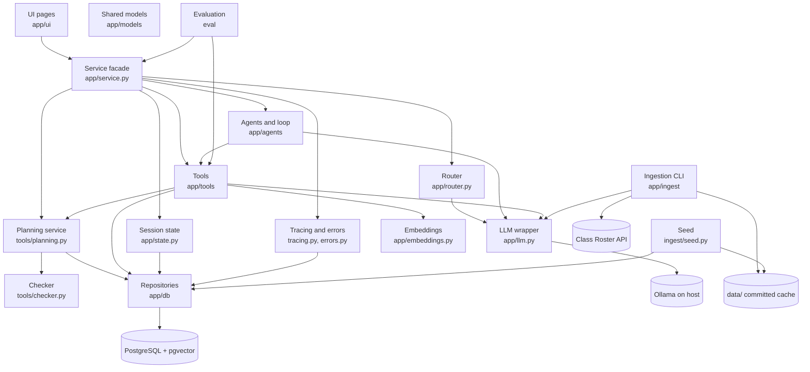
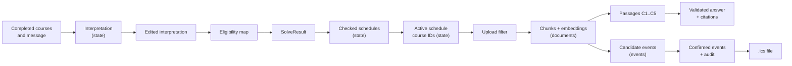

# Component Dependencies

## 1. Dependency Rules

These rules are enforced by import-boundary tests in the test suite. Each rule's reason follows the dash.

1. **R1.** `app/ui/*` imports **only** `app.service` and `app.models`. — Q2:A
2. **R2.** Only `app/llm.py` imports `ollama`. — TC-03
3. **R3.** Only `app/db/*` contains SQL or imports `psycopg`. — TC-04
4. **R4.** `app/tools/checker.py` imports only `app.models` and the standard library. It never imports `solver`, `planning` or their helpers. — Q4:A
5. **R5.** `app/tools/*` never imports `app.agents`, `app.router` or `app.service`. — Prevents cycles
6. **R6.** `app/agents/*` never imports `app.service`. — Prevents cycles
7. **R7.** `app/ingest/*` is not imported by the running app, **except** `app.ingest.trust_gate` (pure), which `seed` uses, and `seed` itself, which startup calls. — The app makes no HTTP calls at runtime
8. **R8.** Nothing in `app/` imports `eval/`. — FR-EVAL-05
9. **R9.** Only `app/ingest/sources/*` imports `httpx`. — The app makes no outbound calls at runtime
10. **R10.** `app/models/*` imports only `pydantic` and the standard library. — The neutral shared layer
11. **R11.** **Ownership never comes from the model.** Model-facing tool input models never declare a session ID or student-data field. Tools receive the session only through the server-built `AgentContext`. Every document, event or active-course ID a tool or service action receives passes `app.tools.ownership` before use, and planner course and section IDs must exist in the catalog. Enforced by a test that inspects every registered `input_model`, plus a test for each tool using another session's IDs. — AD-12, MS-02, SECURITY-05/11
12. **R12.** `INTERPRET_SPEC`'s allowlist contains only `search_courses`. Enforced by a test. — AD-11

---

## 2. Layer Diagram

**Text alternative.** Arrows mean "depends on":
- **Presentation:** UI → Service facade.
- **Service facade** → Router, Agents, Planning service, Tools (for button actions), Session state, Tracing and errors.
- **Router** → LLM wrapper.
- **Agents** → Tools, LLM wrapper.
- **Tools:** Tools → Planning service (through the `solve_schedule` wrapper), Repositories, Embeddings, LLM wrapper (only `extract_deadlines`).
- **Planning service** → Checker, Repositories. The checker depends only on shared models.
- **State and tracing:** Session state → Repositories. Tracing → Repositories.
- **External:** Repositories → PostgreSQL. LLM wrapper → Ollama on the host.
- **Offline:** the ingestion CLI → Class Roster API, LLM wrapper, `data/`. Seed → `data/`, Repositories.
- **Evaluation** → Service facade, Tools.
- **Shared models** (not drawn) are used by every layer and depend on nothing else in `app/`.

There are no cycles: every arrow points toward a lower layer, and `solve_schedule` (a tool) calls the planning service, which never calls back into tools or agents.

---

## 3. Dependency Matrix

`●` = direct dependency, `○` = through the tool wrapper only.

| From \ To | service | router | agents | planning | tools | checker | state | tracing/errors | llm | embeddings | db | models |
|---|---|---|---|---|---|---|---|---|---|---|---|---|
| **ui** | ● | | | | | | | | | | | ● |
| **service** | | ● | ● | ● | ● | | ● | ● | | | | ● |
| **router** | | | | | | | | ● | ● | | | ● |
| **agents** | | | | ○ | ● | | | ● | ● | | | ● |
| **planning** | | | | | ● (`check_prereqs`) | ● | | ● | | | ● | ● |
| **tools** | | | | ● (`solve_schedule`) | | | | ● | ● (deadlines) | ● | ● | ● |
| **checker** | | | | | | | | | | | | ● |
| **state** | | | | | | | | | | | ● | ● |
| **ingest** | | | | | | | | ● | ● | | ● (seed) | ● |
| **eval** | ● | | | | ● | | | | | | | ● |

`planning` depends on the `check_prereqs` **function** in `tools/prereqs.py`, a deterministic module, and the `solve_schedule` tool wrapper in `tools/solve_tool.py` depends on `planning`. `tools/solver.py` holds only the CP-SAT model (SO-1) and has no tool wrapper. So `prereqs.py` ← `planning.py` ← `solve_tool.py`, with no module in that chain importing back. Functional Design will confirm the module split.

---

## 4. Communication Patterns

| Pattern | Where |
|---|---|
| **Synchronous in-process calls** | Everything inside the `app` container (Q7:A). There are no queues or threads |
| **Request-scoped state** | `SessionState` is loaded at the start of each service call and saved at the end, as one `jsonb` document (Q3:A) |
| **Tool calling through an allowlist** | Model → `run_agent` → validate → tool function → result or structured `ToolError` → model |
| **Structured output** | The router, `interpret`, rewriting and derivation use `chat_structured` with one retry |
| **Database** | `psycopg` 3 over the Compose network. The `db` port is not published to the host (NFR-SEC-01) |
| **Model runtime** | HTTP to Ollama on the host (`OLLAMA_HOST`), only through `app/llm.py` |
| **Offline artifacts** | Ingestion → `data/` (committed) → seed → Postgres |

---

## 5. Data Flow: Plan → Keep → Ask → Export (Tier 1)

**Text alternative.** Completed courses and the message produce an Interpretation, stored in state. The student edits it. Eligibility checks produce an eligibility map, and the solver produces a SolveResult. Checked schedules are stored in state, and the kept schedule's course IDs become the active schedule. Those IDs filter uploads and retrieval. Uploaded documents become chunks with embeddings. Retrieval turns chunks into passages C1–C5, which become a validated answer with citations. Separately, chunks become candidate events, the student confirms them (with audit records), and the confirmed events are exported as an `.ics` file.
