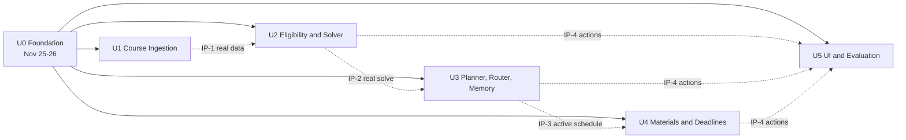

# Unit of Work Dependencies

## 1. Dependency Matrix

Read each row as "the row unit depends on the column unit". **Build** means the unit needs it before its Tier 1 code can run. **Contract** means the unit codes against a U0 contract or fake and integrates later.

| Unit ↓ depends on → | U0 | U1 | U2 | U3 | U4 | U5 |
|---|---|---|---|---|---|---|
| **U0 Foundation** | — | | | | | |
| **U1 Course Ingestion** | Build | — | | | | |
| **U2 Eligibility and Solver** | Build | Contract (fixture catalog, then real data at IP-1) | — | | | |
| **U3 Planner, Router and Memory** | Build | Contract (fixture catalog) | Contract (stub planning service, then real at IP-2) | — | | |
| **U4 Materials and Deadlines** | Build | Contract (anchor from the fixture catalog) | | Contract (an active schedule from the session fake, then real at IP-3) | — | |
| **U5 UI and Evaluation** | Build | | Contract (response models) | Contract (service actions) | Contract (service actions) | — |

- **No cycles.** Every dependency points to a unit built earlier, or to a U0 contract.
- **Hard build dependencies:** only on U0.

---

## 2. Build Order

**Text alternative.** Solid arrows are build dependencies, and dashed arrows are later integration points.
- U0 is built first. U1, U2, U3, U4 and U5 then all start from it in parallel (Q5:A).
- IP-1: U1's real data replaces the fixture catalog in U2.
- IP-2: U2's real solve service replaces the stub in U3.
- IP-3: U3's active-schedule handoff feeds U4.
- IP-4: the service actions from U2, U3 and U4 feed U5's pages.

---

## 3. Integration Contracts (published by U0)

| Contract | Defined in | Used by | Fake or stand-in until integration |
|---|---|---|---|
| Shared models (`Course`, `PrereqRecord`, `TopicTag`, `Interpretation`, `ConstraintChanges`, `SolveResult`, `Schedule`, `Chunk`, `Passage`, `CandidateEvent`, …) | `app/models/` | All | (the real models) |
| Ingestion output format (`DerivedRecordEnvelope` + raw export schema) | `app/models/derived.py` | U1 writes; U0 fixture seed, U2, U3 read | `tests/fixtures/catalog/` |
| `courses_repo` and `derived_repo` read API | `app/db/` | U2, U3, U4 | The fixture seed |
| `solve_with_checks(interpretation, changes, state, *, trace) -> SolveResult` | `component-methods.md` §7 | U3 | `tests/fakes/planning.py` |
| `AgentSpec`, `AgentContext`, `run_agent`, `ToolError` | `app/agents/loop.py` | U3, U4 | (the real loop) |
| `llm.chat` and `llm.chat_structured` | `app/llm.py` | U1, U3, U4 | `tests/fakes/llm.py` |
| `ownership.require_*` | `app/tools/ownership.py` | U2, U3, U4 and the service actions | (the real checks) |
| `SessionState` with `active_schedule` | `app/state.py` | U3 writes, U4 reads | `tests/fakes/session.py` |
| Service action signatures and response models | `component-methods.md` §2 | U5 | Response-model fixtures |

**Contract change rule.** A change to any row above needs a PR reviewed by **every** unit that uses that contract. Changes to response models are also reviewed by UX (Q7:A).

---

## 4. Integration Points and Checks

| ID | Integration | When (target) | Check |
|---|---|---|---|
| IP-1 | U1's real FA26 CS data replaces the fixture catalog | ~Nov 29 | U2 and U3 tests pass against the seeded real data. Demo-script courses exist (or the script is updated to checked courses) |
| IP-2 | U2's real `solve_with_checks` replaces U3's stub | ~Nov 30 | Demo steps 2–5 work end to end through `handle_message` and `solve_confirmed` |
| IP-3 | U3's `keep_schedule` feeds U4's ownership checks and filters | ~Dec 1 | Demo steps 6–10. **README checkpoint: schedule → keep → upload → open a citation** |
| IP-4 | The U2, U3 and U4 actions feed the U5 pages | Rolling, Dec 1–7 | Each story's UI checklist is satisfied through the UI |
| IP-5 | Full Tier 1 demo | By Dec 7 | All 14 demo-script steps, including the Google Calendar import (README Dec 2–7 check) |

---

## 5. Construction Sequencing

### 5.1 Order (Q5:A)
1. **U0**: all four owners, about 1–2 days.
2. **U1, U2, U3 and U4 in parallel.** Each owner drives the coding agent on their own branch. U5's Tier 1 UI follows the service actions as they land.
3. **Tier 2 passes (Q6:A).** Each unit returns for a lighter second pass after its Tier 1 pass and after IP-5 is on track.
4. **Build and Test** once all units are done (Dec 8–12, with the evaluation).

### 5.2 Per-unit stages
These are adjusted from the execution plan's provisional table to the final units.

| Unit | Functional Design | NFR Requirements | NFR Design | Code Generation | Tier passes |
|---|---|---|---|---|---|
| U0 | Minimal (contracts for the agent loop, state, ownership and the fixture format) | **Yes: project-wide, minimal, run once here** | Yes (error handler, logging, allowlist, ownership, no default credentials, container hardening) | Yes | 1 |
| U1 | Yes (statuses, trust gate, cache key, anchor, seed re-check) | — (covered by U0) | Yes (trust gate, prompt-injection handling, API-response validation, MC-04/05) | Yes | 1, 2 |
| U2 | Yes (three-valued logic, CP-SAT model, inclusions and fill, distinctness, checker) | — | Skip (no security-critical logic beyond U0's ownership checks) | Yes | 1, 2 |
| U3 | Yes (interpretation, clarification rules, refinement into `ConstraintChanges`, memory) | — | Light (`AgentContext` construction, per-stage allowlists R11/R12) | Yes | 1, 2, (3) |
| U4 | Yes (chunking, RRF, citation validity, date resolution, `.ics` mapping) | — | Yes (upload validation, citation validation, event audit, session-filtered repositories, MC-06/07) | Yes | 1, 2 |
| U5 | Skip for the UI. Minimal for the evaluation harness in the Tier 2 pass | — | Skip | Yes | 1, 2 |

Infrastructure Design is skipped for every unit (execution plan). U0's NFR Design covers the container settings.

### 5.3 State tracking
`aidlc-state.md` has a **per-unit table** with one row per unit and pass, showing the current stage and status (Q5:A). Each coding-agent session reads it first, and updates to it follow the one-at-a-time merge rule for `aidlc-docs/` (Q4:A).
