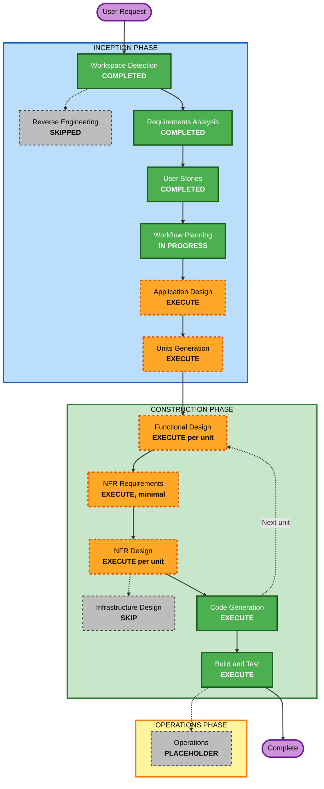

# Execution Plan

**Stage**: INCEPTION - Workflow Planning
**Date**: 2026-11-24
**Inputs**: `requirements.md` (79 FRs, DEC-01 to DEC-25, tiers in §10), `stories.md` (22 user stories, 3 misuse stories, the Tier 1 demo script), `personas.md`, `technical-environment.md`
**Deadline**: December 16 (22 days from today)

---

## Detailed Analysis Summary

### Transformation Scope
Not applicable. This is a greenfield project with no existing code.

### Change Impact Assessment
| Area | Impact | Description |
|---|---|---|
| **User-facing changes** | Yes | The whole Streamlit app: chat, interpretation panel, schedule comparison, citation viewer, deadline review table and trace viewer |
| **Structural changes** | Yes | A new system: ingestion pipeline, router, two agents sharing a loop, 7 tools, CP-SAT solver plus a separate checker, hybrid RAG, session memory and tracing |
| **Data model changes** | Yes | A new Postgres schema for courses, sections, meetings, derived rules, tags, workload signals, requirement categories and their cache, sessions, messages, document chunks and embeddings, events with audit records, and traces |
| **API changes** | Yes (internal) | No REST API. The contracts are `handle_message` (the UI entry point), the 7 tool input and output models, the router decision, `SessionState` and the `CourseSource` adapter. These are shared by four owners, so they must be fixed early |
| **NFR impact** | Yes | Security Baseline (blocking), PBT Partial (blocking), fail-safe derivation (0 false `met`), 0 hard-rule violations, and soft latency targets on local models |

### Risk Assessment
- **Risk level**: **High.**
  - The rules are derived by small local models but must meet hard correctness guarantees.
  - Four owners integrate through shared contracts.
  - The deadline is 22 days away, spanning Thanksgiving.
  - The Class Roster API's fields haven't been verified yet (vision open question 3).
- **Rollback complexity**: Easy. The project is greenfield and uses git.
- **Testing complexity**: Complex. The tests combine deterministic unit tests, property tests, live model tests (`-m live`), and an evaluation runner with 8 suites.

**Main schedule risks and how this plan responds:**
1. *Integration late in the project.* The shared contracts are fixed in Application Design, and a Foundation unit is built first (see Units Generation).
2. *Ingestion assumptions.* Checking the Class Roster API fields is the first task of the ingestion unit's Functional Design. If a field is missing, it is stored as missing per FR-ING-02.
3. *Too many process gates for 22 days.* The per-unit design stages run only where they add value (see the per-unit table below).

---

## Workflow Visualization



### Text Alternative
```
Phase 1: INCEPTION
- Workspace Detection ........ COMPLETED
- Reverse Engineering ........ SKIPPED (greenfield)
- Requirements Analysis ...... COMPLETED
- User Stories ............... COMPLETED
- Workflow Planning .......... IN PROGRESS
- Application Design ......... EXECUTE
- Units Generation ........... EXECUTE

Phase 2: CONSTRUCTION (per unit, Foundation unit first)
- Functional Design .......... EXECUTE (only for units with business logic)
- NFR Requirements ........... EXECUTE (minimal; once for the project)
- NFR Design ................. EXECUTE (only for units with security-critical logic)
- Infrastructure Design ...... SKIP
- Code Generation ............ EXECUTE (every unit)
- Build and Test ............. EXECUTE (once, after all units)

Phase 3: OPERATIONS
- Operations ................. PLACEHOLDER
```

---

## Phases to Execute

### 🔵 INCEPTION PHASE
- [x] Workspace Detection (COMPLETED)
- [x] Reverse Engineering (SKIPPED: greenfield)
- [x] Requirements Analysis (COMPLETED)
- [x] User Stories (COMPLETED)
- [x] Workflow Planning (IN PROGRESS)
- [ ] **Application Design: EXECUTE** (standard depth)
  - **Rationale**: Every component is new: `service.handle_message`, the router, the planner and materials agents, the shared agent loop, 7 tools, the separate checker, `app/ingest/` (`CourseSource`, derivation, trust gate, cache), `app/db/` repositories, `SessionState` and tracing. Four owners need agreed method signatures and Pydantic contracts before they build in parallel. NFR-SEC-11 also requires misuse cases in the design documentation (MS-01 to MS-03 are the starting point).
- [ ] **Units Generation: EXECUTE** (standard depth)
  - **Rationale**: The work splits naturally along the four owner areas (DATA, PLAN, MAT, UX) and needs an explicit dependency order. A likely shape, to be confirmed in that stage, is a shared **Foundation** unit (config, `app/llm.py`, the database schema and migrations, `SessionState`, tracing, the agent loop and Docker) followed by per-area units. Units Generation will also map the Tier 1 stories to units, so that the demo critical path is built first.

### 🟢 CONSTRUCTION PHASE
- [ ] **Functional Design: EXECUTE, per unit, only where business logic exists**
  - **Rationale**: Complex rules need precise design before code: the trust gate and the none/text/missing classification, three-valued evaluation, the CP-SAT model with inclusions, fill and distinctness, the separate checker, requirement-category rules, chunking and RRF retrieval, citation validation, relative-date resolution with DEC-25 weeks, and `.ics` mapping. PBT-01 is advisory under Partial mode, but a "Testable Properties" section will be included because NFR-TEST-05 needs it. Skip for a unit with only wiring or UI.
- [ ] **NFR Requirements: EXECUTE, minimal depth, once for the project** (as part of the first unit)
  - **Rationale**: The tech stack is fixed, but some choices are still open: the dependency vulnerability scanner and the SBOM tool (SECURITY-10, which need a PR per TC-06), recording `hypothesis` as the PBT framework (PBT-09), maximum string lengths and the chat message limit (SECURITY-05), the solver time limit (NFR-PERF-03), and how latency is measured (NFR-PERF-01).
- [ ] **NFR Design: EXECUTE, per unit, only for units with security-critical or fail-closed logic**
  - **Rationale**: SECURITY-11 requires security-critical logic to live in dedicated modules. NFR Design places upload validation, tool-argument validation and the per-agent allowlist, citation validation, the trust gate, the global error handler (SECURITY-15), structured logging (SECURITY-03) and the event audit records (SECURITY-13). Skip for units with no such logic.
- [ ] **Infrastructure Design: SKIP**
  - **Rationale**: There is no cloud and nothing to provision. The deployment (Docker Compose with `db` and `app`, Ollama on the host, `localhost` binding) is fixed in technical-environment.md §2. The security adaptations (unpublished database port, pinned image tags, non-root containers, placeholder password) are small configuration items. They are handled in the Foundation unit's NFR Design and Code Generation, with verification in Build and Test.
- [ ] **Code Generation: EXECUTE** (ALWAYS, per unit)
  - **Rationale**: Implementation planning and code generation are needed, including the example-based and property-based tests from NFR-TEST-05.
- [ ] **Build and Test: EXECUTE** (ALWAYS)
  - **Rationale**: Build, test and verification are needed: `uv run pytest`, `-m live`, `ruff`, `mypy`, the scanner, PBT seed logging (PBT-08), and the evaluation runner.

### 🟡 OPERATIONS PHASE
- [ ] Operations: PLACEHOLDER
  - **Rationale**: The workflows for future deployment and monitoring. Nothing is deployed for this project.

### Per-unit stage applicability (provisional; confirmed in Units Generation)
| Likely unit | Owner | Functional Design | NFR Design | Notes |
|---|---|---|---|---|
| Foundation (config, LLM wrapper, database schema, state, tracing, agent loop, Docker) | Shared, led by UX + PLAN | Minimal (agent-loop and state contracts) | Yes (error handler, logging, tool allowlist, no default credentials) | Built first. Unblocks everyone else |
| Ingestion and course data | DATA | Yes (trust gate, statuses, anchor, cache) | Yes (trust gate, prompt-injection handling) | Starts with checking the Class Roster API fields |
| Eligibility and solver | DATA | Yes (three-valued logic, CP-SAT, checker, fill, distinctness) | No | The heaviest property-testing target |
| Planner, router and memory | PLAN | Yes (interpretation, refinement, routing and clarification, summaries) | Light (argument validation) | |
| Materials and deadlines | MAT | Yes (chunking, RRF, rewriting, citation validity, dates, `.ics`) | Yes (upload validation, citation validation, event audit) | |
| UI and evaluation | UX | Skip, or minimal for the evaluation runner | No | UI follows the story UI checklists |

---

## Estimated Timeline

The phases align with the README milestones and the tiers in requirements §10.

| Dates | Stages | Exit check |
|---|---|---|
| Nov 24–25 | Application Design, Units Generation | Contracts and units approved |
| Nov 25–Dec 1 | Foundation, then the Tier 1 parts of Ingestion, Eligibility and solver, Planner and Materials (design + code per unit) | README check: schedule → keep → upload → open a citation |
| Dec 2–7 | Tier 1 deadline review and export, then Tier 2 stories | README check: refinement plus a confirmed deadline imported into a calendar |
| Dec 8–12 | Build and Test, the evaluation runs, fixes | Evaluation report with counts, metrics, tokens and latency |
| Dec 13–15 | Buffer, demo rehearsal, Tier 3 only if Tier 2 is done | A teammate runs the demo script from a fresh setup |
| Dec 16 | Submit | Repository, README, AI-DLC artifacts, evaluation report |

- **Stages remaining**: 2 Inception stages, then up to 4 Construction stages per unit, then Build and Test.
- **Parallelism**: after Foundation, each owner runs their unit's design and code stages in parallel, with approval gates at the weekly meeting or asynchronously in the group chat.

---

## Success Criteria
- **Primary goal**: the Tier 1 demo script (`stories.md`, 14 steps) runs end to end from a fresh setup by December 16, with 0 hard-rule violations and 0 false `met`.
- **Key deliverables**: the working app; the ingestion pipeline; the test suite (unit, property and live tests); the evaluation report for all suites in requirements §7; the README; and the AI-DLC artifacts.
- **Quality gates**:
  - Security Baseline: no blocking findings at any stage.
  - PBT Partial: PBT-02, 03, 07, 08 and 09 compliant.
  - `ruff` and `mypy` clean.
  - 80% coverage on the targeted modules.
  - Every displayed schedule passes the separate checker.

---

## Extension Compliance at This Stage
| Extension | Status |
|---|---|
| Security Baseline | Compliant. This plan creates no code or infrastructure. It schedules where each enforced rule is designed and verified: SECURITY-11 misuse cases in Application Design; SECURITY-10 tool choices in NFR Requirements; SECURITY-03, 05, 09, 13 and 15 placement in NFR Design; verification in Build and Test. N/A rules are unchanged |
| PBT (Partial) | Compliant. PBT-09 (framework) is confirmed in NFR Requirements. Properties are identified in Functional Design. PBT-08 seed logging is covered in Build and Test |
| Resiliency | Disabled |
